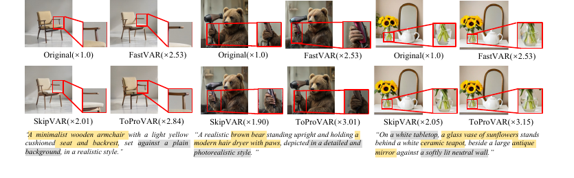

# ToProVAR

<div align="center">

<h2>ToProVAR: Efficient Visual Autoregressive Modeling via Tri-Dimensional Entropy-Aware Semantic Analysis and Sparsity Optimization</h2>

**ICLR 2026**

Jiayu Chen, Ruoyu Lin, Zihao Zheng, Jingxin Li, Maoliang Li, Guojie Luo, Xiang Chen

[](https://arxiv.org/abs/2602.22948)
[](https://github.com/IF-LAB-PKU/ToProVAR)
[](LICENSE)



</div>

> **Abstract:** Visual Autoregressive (VAR) models enhance generation quality but face a critical efficiency bottleneck in later stages. ToProVAR introduces a tri-dimensional entropy-aware optimization framework for VAR models. Instead of relying on heuristic skipping or one-dimensional token pruning, ToProVAR analyzes semantic projections across token, layer, and scale dimensions, then applies fine-grained sparsity optimization tailored to these patterns. Experiments on Infinity-2B and Infinity-8B show up to **3.4x acceleration** with minimal quality loss.

If this work is useful for your research, please consider citing ToProVAR.

## Highlights

- **Tri-dimensional sparsity analysis:** ToProVAR jointly considers token-level semantic salience, layer-level semantic scope, and scale-level semantic fineness.
- **Efficient VAR inference:** The current open-source release focuses on the verified ToProVAR inference path on the Infinity runtime.
- **Quality-preserving acceleration:** The method is designed to accelerate later VAR generation stages while preserving semantic fidelity and fine details.
- **Reproducible setup path:** Users can either create the verified fresh environment or add ToProVAR-specific dependencies to an existing Infinity environment.

Why ToProVAR? Existing VAR acceleration methods such as FastVAR and SkipVAR mainly optimize from a single dimension, which can prune semantically important tokens, distort object structure, or skip scales needed for fine details. ToProVAR instead uses attention entropy to guide pruning jointly across token, layer, and scale dimensions.

## Contents

- [News](#news)
- [Get Started](#get-started)
- [Repository Layout](#repository-layout)
- [Development Policy](#development-policy)
- [Acknowledgements](#acknowledgements)
- [Citation](#citation)
- [License](#license)
- [Contact](#contact)

## News

- **2026-02-26:** arXiv paper available.
- **2026:** ToProVAR accepted to ICLR 2026.

## Get Started

We apply ToProVAR to the Infinity text-to-image VAR runtime in this release. Following the paper-code release style used by FastVAR, this repository keeps the modified Infinity/HART runtime source in tree and leaves the CUDA attention kernel as an environment dependency. If you already have an upstream Infinity environment that can run inference, use Option B to add only the ToProVAR-specific pieces. If you want the most reproducible path, use Option A.

ToProVAR requires an entropy-enabled FlashAttention build that provides `flash_attn_func_with_entropy`. The public PyPI `flash-attn` package is not a drop-in replacement for the current inference path. In the verified research environment this dependency is installed from a prepared local `flash_attn` source/build directory with:

```bash
cd /path/to/entropy-enabled/flash_attn
FLASH_ATTENTION_SKIP_CUDA_BUILD=TRUE python -m pip install -e .
```

### Verified Runtime Assumptions

The examples below assume a CUDA-capable environment where this repository is available at `/workspace` and model weights are available under `/data/models`. You can replace both paths for your own machine or container.

If you are using Docker, enter your container first:

```bash
bash docker_build.sh
HOST_DATA_DIR=/path/to/models-root bash docker_open.sh
```

The provided Dockerfile is a minimal CUDA base container for mounting this repository and your model directory. It is not a full reproducible training or inference image: create or activate a Python/conda environment inside the container, install `requirements.txt`, and install the entropy-enabled FlashAttention build before running inference. CUDA-capable GPU access is expected.

### Option A: Verified Fresh Environment

This is the recommended path for reproducing the verified README setup from a clean conda environment. If you use the provided Docker container, run these commands after entering the container.

```bash
source /opt/conda/etc/profile.d/conda.sh
conda create -n toprovar python=3.10 -y
conda activate toprovar

cd /workspace
git config --global --add safe.directory /workspace
python -m pip install "pip==24.0" "setuptools==78.1.1" wheel
python -m pip install -r requirements.txt

cd /path/to/entropy-enabled/flash_attn
FLASH_ATTENTION_SKIP_CUDA_BUILD=TRUE python -m pip install -e .

cd /workspace/Entropy/Infinity
```

Verify the customized attention dependency:

```bash
python - <<'PY'
from flash_attn import flash_attn_func_with_entropy
print(callable(flash_attn_func_with_entropy))
PY
```

Expected output:

```text
True
```

### Option B: Existing Infinity Environment

If you already have a conda environment that can run upstream Infinity inference, activate it first and then install the ToProVAR additions from this repository:

```bash
source /opt/conda/etc/profile.d/conda.sh
conda activate <your-infinity-env>

cd /workspace
python -m pip install -r requirements.txt

cd /path/to/entropy-enabled/flash_attn
FLASH_ATTENTION_SKIP_CUDA_BUILD=TRUE python -m pip install -e .

cd /workspace/Entropy/Infinity
bash simple_inference_8b_toprovar_pruning.sh
```

This route is intended for users who already have the upstream Infinity model environment working. If dependency conflicts appear, use Option A, which is the currently verified clean installation path.

### Quickstart Inference

After either Option A or Option B, run the preferred ToProVAR 8B smoke test. The default quickstart enables adaptive scale selection via `--use_adaptive_scale`:

```bash
cd /workspace/Entropy/Infinity
bash simple_inference_8b_toprovar_pruning.sh
```

The script defaults to `/data/models` for weights and GPU `0`. You may override these without editing the script:

```bash
TOPROVAR_MODEL_ROOT=/path/to/models CUDA_VISIBLE_DEVICES=1 bash simple_inference_8b_toprovar_pruning.sh
```

Outputs are written under `Entropy/Infinity/outputs/`. For the exact inference arguments used by the smoke test, see `Entropy/Infinity/simple_inference_8b_toprovar_pruning.sh`. Fixed start-scale runs can still be reproduced by calling `tools/run_infinity.py` directly without `--use_adaptive_scale`.

### Model Weights

Model weights are not included in Git. The quickstart scripts expect this directory layout by default:

```text
/data/models/
├── flan-t5-xl/
└── infinity-2b/
    ├── infinity_2b_reg.pth
    ├── infinity_vae_d32reg.pth
    └── infinity_vae_d56_f8_14_patchify.pth
└── infinity-8b/
```

For the 8B quickstart, the required paths are:

```text
/data/models/infinity-8b
/data/models/infinity-2b/infinity_vae_d56_f8_14_patchify.pth
/data/models/flan-t5-xl
```

For the 2B quickstart, the required paths are:

```text
/data/models/infinity-2b/infinity_2b_reg.pth
/data/models/infinity-2b/infinity_vae_d32reg.pth
/data/models/flan-t5-xl
```

Set `TOPROVAR_MODEL_ROOT=/path/to/models` if your files live somewhere else. Model download URLs and checksums should follow the corresponding upstream Infinity and text encoder releases.

### Optional Evaluation Dependencies

The inference quickstart only requires `requirements.txt`. Evaluation utilities have extra dependencies that can be installed separately:

```bash
python -m pip install -r requirements-eval.txt
```

GenEval and the optional scoring utilities depend on their official benchmark assets and environment assumptions. See `Entropy/Infinity/evaluation/README.md` before running full benchmark reproduction.

## Repository Layout

```text
.
├── assets/                        # README figures
├── Entropy/Infinity/              # Main Infinity/ToProVAR runtime
│   ├── infinity/                  # Python package and model/runtime code
│   ├── tools/run_infinity.py      # Primary inference entry point
│   ├── simple_inference_*.sh      # Inference helper scripts
│   ├── scripts/                   # Evaluation, benchmark, and experiment scripts
│   └── evaluation/                # GenEval, HPSv2, ImageReward, MJHQ/FID/CLIP utilities
├── Entropy/hart/                  # HART-related package and docs
├── requirements.txt               # Python requirements
├── requirements-eval.txt          # Optional evaluation requirements
├── docker_build.sh                # Docker build helper
└── docker_open.sh                 # Docker open/run helper
```

The most important runtime directory for the current inference workflow is `Entropy/Infinity`.

## Development Policy

Do not commit generated or local runtime artifacts, including:

- Model weights, checkpoints, VAE files, text encoder weights, and downloaded model files.
- Inference outputs, generated images, evaluation result folders, and benchmark outputs.
- Cache directories, Python bytecode, compiled extensions, and build products.
- Logs, profiling output, timing dumps, local environment files, and temporary files.

Contributions should preserve the verified inference behavior. Changes that may affect generation results, runtime speed, pruning behavior, model loading, entropy/SVD/adaptive logic, or default inference parameters should be treated as algorithm-sensitive and validated separately.

## Acknowledgements

ToProVAR builds on the open-source visual autoregressive generation ecosystem. We thank the authors of Infinity, FastVAR, SkipVAR, DPG-Bench, GenEval, HPSv2, and ImageReward for their public research and code releases.

We also used FastVAR's public paper-code release style as a reference for providing modified backbone source directly in this repository.

## Citation

Please cite ToProVAR if this work is useful for your research:

```bibtex
@inproceedings{chentoprovar,
  title={ToProVAR: Efficient Visual Autoregressive Modeling via Tri-Dimensional Entropy-Aware Semantic Analysis and Sparsity Optimization},
  author={Chen, Jiayu and Lin, Ruoyu and Zheng, Zihao and Li, Jingxin and Li, Maoliang and Luo, Guojie and Chen, Xiang},
  booktitle={The Fourteenth International Conference on Learning Representations},
  year={2026}
}
```

## License

ToProVAR additions in this repository are released under the MIT License; see [LICENSE](LICENSE).

This project builds on and/or references third-party projects with their own licenses, including Infinity, HART, FlashAttention, FastVAR, SkipVAR, DPG-Bench, GenEval, HPSv2, and ImageReward. Users are responsible for following the license terms of the corresponding backbone models, benchmark assets, and optional evaluation dependencies.

## Contact

For questions about the paper or code release, please use the GitHub issue tracker once the public repository is available.
